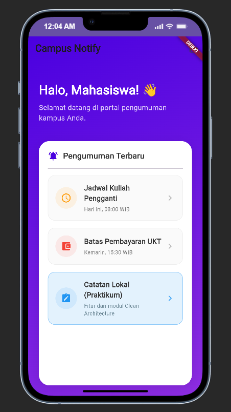

# Minggu 9: AI-Assisted Development & Vibe Coding

**Mata Kuliah:** Pemrograman Mobile  
**Nama Mahasiswa:** Mochammad Alfan Fadhilah  
**NIM:** 254107023007  
**Topik Pembelajaran:** #09 AI-Assisted Development / Vibe Coding  
**Proyek Basis:** Campus Notify & Offline Notes (`Week7_Clean Architecture/campus_notify`)  

---

## 🎯 1. Konsep Workflow AI vs Vibe Coding

Dalam era pengembangan mobile modern, pemanfaatan kecerdasan buatan (AI) dapat menjadi akselerator produktivitas yang luar biasa atau sebaliknya menjadi bencana pemeliharaan kode (*technical debt*) bila terjebak dalam perangkap **"Vibe Coding"**—yaitu kebiasaan menerima kode AI secara buta tanpa memahami alur, tanpa verifikasi, dan tanpa pengujian.

### 1.1 Siklus Disiplin: Generate sampai Explain
Prinsip utama: **"AI mengusulkan, developer memutuskan."**

```
[1. Prompt] ──> [2. Generate] ──> [3. Verify] ──> [4. Test] ──> [5. Refactor] ──> [6. Explain]
    (Konteks        (Usulan AI)      (Baca, Grep,    (Analyze &       (Clean          (Paham Penuh
     5 Slot)                          Cek API)         Tests)      Architecture)     Tanpa AI)
```
> [!IMPORTANT]
> Gagal di langkah 3–6 adalah definisi dari **Vibe Coding**: sangat cepat di awal pembuatan, namun sangat mahal dan rapuh di akhir ketika aplikasi masuk ke tahap pemeliharaan.

### 1.2 Matriks Kekuatan dan Risiko AI
- **Area Kuat (Manfaatkan & Tetap Uji):** Pembuatan boilerplate kelas, pola umum (regex, konversi JSON), draft skenario pengujian unit, penyusunan dokumentasi markdown.
- **Area Lemah (Wajib Verifikasi Ekstra):** API library baru, migrasi versi mayor paket, logika bisnis spesifik/domain rules, integrasi multi-state.
- **Area Berbahaya (Dilarang Menggunakan AI Mentah):** Penanganan token autentikasi (JWT, OAuth), query SQL mentah, dan aturan keamanan. Jangan pernah menempel kredensial asli ke AI (gunakan placeholder `TOKEN_PLACEHOLDER`).

---

## 🕵️ 2. Tiga Pola Halusinasi Flutter & Bukti Verifikasi

| Pola Halusinasi | Karakteristik / Gejala | Contoh Nyata pada Modul Ini | Bukti & Solusi Rekayasa |
|---|---|---|---|
| **Package Kadaluarsa** | AI menggunakan API versi lama yang sudah usang atau dihapus di versi mutakhir. | AI mengusulkan `final searchQueryProvider = StateProvider<String>((ref) => '');`. | Kompilator error: `Method not found: 'StateProvider'`. Dependensi menggunakan `flutter_riverpod: ^3.4.3` (v3 telah menghapus StateProvider). Solusi: Menggunakan `Notifier<String>` dengan `NotifierProvider`. |
| **Logika Yakin tapi Salah** | Kode terlihat rapi dan meyakinkan, namun memiliki cacat logika fundamental. | Filter awal AI: `note.title.contains(query)` (Case-Sensitive). | Saat mencari `"belanja"`, catatan `"Belanja Bulanan"` tidak muncul. Dibuktikan via *test merah*, lalu diperbaiki dengan `.trim().toLowerCase()`. |
| **Pelanggaran Arsitektur** | AI menempatkan logika bisnis atau panggilan data mentah di tempat yang salah demi kepraktisan semu. | AI menaruh fungsi filter langsung di dalam method widget `build()`. | Terdeteksi via audit arsitektur. Logika dipindahkan ke *Domain Use Case* murni `SearchNotes`. |

---

## 📝 3. Praktikum 1: Prompt & Context Engineering

### Formula 5 Slot yang Diterapkan:
1. **Peran:** Senior Flutter Architect & Clean Architecture Specialist.
2. **Konteks:** Fitur catatan kampus berbasis *Feature-First Clean Architecture*, `flutter_riverpod: ^3.4.3`, SQLite lokal, dan Dio.
3. **Tugas:** Tambahkan fungsionalitas pencarian judul catatan (*search notes by title*) dan status tampilan kosong (*empty state*) ketika hasil tidak ditemukan.
4. **Batas:** Jangan merusak arsitektur (dilarang memanggil database dari UI atau mengimpor Flutter di domain layer), panjang fungsi UI di bawah 40 baris.
5. **Output:** Kode domain use case murni, notifier state Riverpod 3, widget pencarian dengan empty state, serta unit & widget test.

*Dokumentasi log prompt dan analisis detail:*  
📄 [Dokumentasi Lengkap di docs/ai-log.md](docs/ai-log.md)

---

## 🏗️ 4. Praktikum 2 & 3: Arsitektur Fitur Search & Empty State

Implementasi mengikuti pemisahan tanggung jawab yang ketat:

```
UI Widget (NotesPage) ──> Notifier (SearchQueryNotifier)
        │                               │
        ▼                               ▼
Empty State / List <───── Selector (filteredNotesProvider)
                                        │
                                        ▼
                            Use Case (SearchNotes Domain)
                                        │
                                        ▼
                            Repository (NoteRepository Data)
```

1. **Domain Layer:** [`SearchNotes`](file:///d:/POLINEMA/SEMESTER%205/Pemrograman%20Mobile/254107023007-mobile-course/Week7_Clean%20Architecture/campus_notify/lib/features/notes/domain/usecases/search_notes.dart) adalah kelas murni Dart yang mengisolasi aturan pemfilteran case-insensitive.
2. **Presentation Layer:**
   - [`SearchQueryNotifier`](file:///d:/POLINEMA/SEMESTER%205/Pemrograman%20Mobile/254107023007-mobile-course/Week7_Clean%20Architecture/campus_notify/lib/features/notes/presentation/providers/notes_providers.dart) mengelola state string query secara reaktif.
   - [`filteredNotesProvider`](file:///d:/POLINEMA/SEMESTER%205/Pemrograman%20Mobile/254107023007-mobile-course/Week7_Clean%20Architecture/campus_notify/lib/features/notes/presentation/providers/notes_providers.dart) menggabungkan daftar catatan dari database dengan use case pencarian.
   - [`NotesPage`](file:///d:/POLINEMA/SEMESTER%205/Pemrograman%20Mobile/254107023007-mobile-course/Week7_Clean%20Architecture/campus_notify/lib/features/notes/presentation/pages/notes_page.dart) dipecah menjadi fungsi-fungsi kecil berukuran < 40 baris (`_buildSearchBar`, `_buildEmptySearchResult`, `_buildNotesList`).

---

## 🧪 5. Bukti Mesin Hijau (Quality Gates)

### 5.1 Analisis Statis (`flutter analyze`)
```text
Analyzing campus_notify...
No issues found! (ran in 10.0s)
```
*Status: 0 issues, bersih dari peringatan maupun import lintas layer.*

### 5.2 Format Kode (`dart format --set-exit-if-changed .`)
```text
Formatted 29 files (0 changed) in 0.18 seconds.
```
*Status: Seluruh 29 file Dart mematuhi standar formatting resmi.*

### 5.3 Eksekusi Pengujian Otomatis (`flutter test`)
Pengujian mencakup unit test use case dan widget test UI:
```text
00:00 +0: SearchNotes UseCase Tests: filter abaikan huruf besar/kecil (case-insensitive search)
00:00 +1: SearchNotes UseCase Tests: query tak cocok kembalikan kosong
00:00 +2: SearchNotes UseCase Tests: query kosong atau hanya spasi mengembalikan seluruh daftar catatan
00:00 +3: SearchNotes UseCase Tests: pencarian substring berhasil mencocokkan bagian judul
00:00 +4: Menampilkan Empty State yang tepat saat pencarian tidak menemukan hasil
00:01 +15: All tests passed!
```
*Status: 15 dari 15 test lulus (100% HIJAU).*

---

## 📱 6. Panduan Menjalankan & Uji Manual 3 Query

### Cara Menjalankan:
```bash
cd "Week7_Clean Architecture/campus_notify"
flutter pub get
flutter run
```

### Skenario Uji Manual 3 Query:
1. **Query Kosong (Default State):**
   - Kolom pencarian dibiarkan kosong `""`.
   - *Hasil:* Seluruh daftar catatan ditampilkan secara lengkap.
2. **Query Cocok (Filtered State):**
   - Masukkan kata kunci `"kuliah"` atau `"belanja"`.
   - *Hasil:* Hanya kartu catatan yang memuat substring kata kunci yang muncul. Pencarian bersifat case-insensitive.
3. **Query Tidak Cocok (Empty State):**
   - Masukkan kata kunci acak `"zzz-tak-ada"`.
   - *Hasil:* Komponen **Empty State** muncul dengan icon `search_off`, judul *"Catatan Tidak Ditemukan"*, dan tombol *"Reset Pencarian"*. Menekan tombol reset akan mengembalikan seluruh daftar catatan.

---

## 📸 7. Tangkapan Layar Aplikasi

| Tampilan Beranda Dashboard | Halaman Catatan & Filter Pencarian |
|:---:|:---:|
|  |  |
| *Dashboard portal notifikasi kampus* | *Pencarian judul catatan terintegrasi Clean Architecture* |

---

## 🧠 8. Refleksi Pembelajaran (Reflective Engineering)

1. **Mengapa Vibe Coding Berbahaya bagi Proyek Jangka Panjang?**  
   Vibe coding menciptakan ilusi kecepatan di awal karena fitur tampak langsung berjalan di layar. Namun, tanpa pemahaman arsitektur dan penulisan test, kode tersebut dipenuhi *technical debt*, halusinasi method tersembunyi, kebocoran layer (misal UI memanggil database langsung), dan kerapuhan saat library di-update. Dalam jangka panjang, biaya memperbaiki bug jauh lebih mahal daripada waktu yang dihemat di awal.
2. **Bagaimana Formula 5 Slot Mencegah Halusinasi AI?**  
   Dengan memberikan peran spesifik, batasan arsitektur (misal larangan memanggil SQLite dari widget), dan spesifikasi output yang terukur (3 test case), AI tidak memiliki ruang untuk mengasumsikan pola sembarangan. Konteks yang presisi membatasi ruang probabilitas model bahasa ke solusi yang sesuai dengan arsitektur proyek.
3. **Pentingnya Metode "Test Merah" Sebelum Memperbaiki Kode:**  
   Menulis test merah membuktikan secara objektif bahwa bug benar-benar ada dan dapat direproduksi secara konsisten. Hal ini mencegah pengembang melakukan *trial-and-error* membabi-buta atau sekadar menulis prompt *"tolong perbaiki ini"* tanpa indikator keberhasilan yang terukur. Ketika test merah berubah menjadi hijau, kita memiliki bukti matematis bahwa masalah telah teratasi tanpa efek samping.
