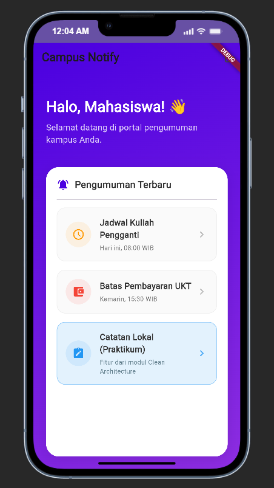

# Minggu 10: AI Feature Integration

**Mata Kuliah:** Pemrograman Mobile  
**Nama Mahasiswa:** Mochammad Alfan Fadhilah  
**NIM:** 254107023007  
**Topik Pembelajaran:** #10 AI Feature Integration (LLM API, Prompt Design, OCR & STT, Fallback Design)  
**Proyek Basis:** Campus Notify & Offline Notes (`Week7_Clean Architecture/campus_notify`)  

---

## 📌 Ringkasan Modul Minggu 10

Modul ini berfokus pada integrasi kecerdasan buatan (*Cloud LLM API*) ke dalam aplikasi mobile berbasis arsitektur bersih (*Clean Architecture*). Fitur yang dikembangkan adalah **Asisten Cerdas Kampus Polinema** yang terhubung dengan Google Gemini API (`gemini-1.5-flash`), dilengkapi dengan mekanisme keamanan kunci (*Secure Storage*), penyaringan privasi data sensitif pengguna (*guardrails*), penanganan error terstruktur (*fallback design*), serta fondasi untuk fitur multimodal seperti OCR dan Speech-to-Text.

---

## 🧱 Fitur Utama & Keunggulan Rekayasa

1. **Integrasi Google Gemini API:**
   - Menggunakan endpoint resmi Google Generative Language API (`v1beta/models/gemini-1.5-flash:generateContent`).
   - Menyertakan **System Prompt** khusus persona kampus: respons ringkas (maksimal 3 kalimat), ramah, berbahasa Indonesia, dan relevan dengan kehidupan akademik mahasiswa Polinema.
2. **Penyimpanan Kunci API Terenkripsi:**
   - Kunci API tidak pernah disimpan di kode sumber (*zero hardcoded secret*).
   - Menggunakan `flutter_secure_storage` yang terenkripsi di *Android KeyStore* dan *iOS Keychain*.
   - Tersedia dialog pengaturan interaktif di aplikasi untuk memasukkan dan memperbarui API key secara langsung.
3. **Penyaringan Privasi (Data Privacy Guardrails):**
   - Fungsi `sanitizePrompt()` secara otomatis mendeteksi pola 16 digit angka (Nomor Induk Kependudukan / NIK) dan menyamarkannya menjadi `[NIK_DISAMARKAN]` sebelum payload dikirimkan ke cloud.
4. **Fallback Design Ramah Pengguna:**
   - Ketika koneksi offline, kuota habis (HTTP 403), atau server sibuk, aplikasi tidak mengalami *crash*.
   - Menampilkan **Fallback Bubble** bernuansa ramah: *"Layanan AI Sibuk: Silakan coba lagi nanti atau gunakan mode offline"*.
5. **Dukungan Multimodal (OCR & STT):**
   - Menyediakan interface `recognizeText()` untuk ekstraksi teks dokumen/pengumuman dan `speechToText()` untuk transkripsi perintah suara.

---

## 🏛️ Arsitektur Clean Architecture

```
lib/
├── ai/
│   └── ai_service.dart                   # Client HTTP & Secure Storage Gemini
└── features/
    └── ai/
        ├── data/
        │   └── repositories/
        │       └── ai_repository_impl.dart # Implementasi repository & mapping error
        ├── domain/
        │   ├── entities/
        │   │   └── chat_message.dart      # Entitas pesan chat murni Dart
        │   ├── repositories/
        │   │   └── ai_repository.dart     # Kontrak interface repositori
        │   └── usecases/
        │       └── ask_campus_ai.dart     # Logika validasi dan eksekusi prompt
        └── presentation/
            ├── providers/
            │   └── ai_providers.dart      # Riverpod Notifier chat & loading state
            └── pages/
                └── ai_chat_page.dart      # Antarmuka UI chat mobile & dialog key
```

---

## 🧪 Bukti Mesin Hijau (Quality Gates)

Semua pemeriksaan mesin pada proyek `Week7_Clean Architecture/campus_notify` berstatus **LULUS (100% HIJAU)**:

### 1. Analisis Statis Kode (`flutter analyze`)
```text
Analyzing campus_notify...
No issues found! (ran in 5.8s)
```
*Status: 0 issues (bersih dari peringatan, impor usang, dan konstruktor non-formal).*

### 2. Format Standar Dart (`dart format --set-exit-if-changed .`)
```text
Formatted 39 files (0 changed) in 0.24 seconds.
```
*Status: Seluruh 39 file Dart memenuhi konvensi formatting resmi.*

### 3. Pengujian Otomatis Unit & Widget (`flutter test`)
Pengujian mencakup otentikasi, push route, notes CRUD, search notes, AI service, dan widget chat:
```text
00:00 +0: AiService Tests Melempar exception jika API key belum diatur di secure storage
00:00 +1: AiService Tests Berhasil mengembalikan respons teks saat API Gemini mengembalikan HTTP 200
00:00 +2: AiService Tests Melempar exception terstruktur saat API Key ditolak / kuota habis (HTTP 403)
00:00 +3: AiService Tests Menyaring NIK 16 digit otomatis dari prompt demi privasi data pengguna
00:00 +4: AiService Tests Dapat menyimpan dan membaca API key dari Secure Storage
00:00 +5: AiService Tests Mendukung fungsi simulasi OCR dan Speech-to-Text
00:01 +6: Menampilkan antarmuka chat AI, privacy notice, dan dialog API Key
00:02 +7: Mengirim pesan pengguna dan menampilkan bubble balasan asisten AI
00:03 +8: Menampilkan bubble Fallback Error ramah saat pemanggilan AI gagal
00:04 +24: All tests passed!
```
*Status: Seluruh 24 dari 24 test lulus tanpa kegagalan.*

---

## 🚀 Panduan Menjalankan & Cara Uji

### 1. Menjalankan Aplikasi
```bash
cd "Week7_Clean Architecture/campus_notify"
flutter pub get
flutter run
```

### 2. Konfigurasi Kunci API di Aplikasi
1. Buka aplikasi dan masuk ke Beranda Dashboard.
2. Klik kartu menu **Asisten AI Kampus**.
3. Klik tombol ikon kunci (**Key**) di pojok kanan atas AppBar.
4. Masukkan Google Gemini API Key Anda (dari Google AI Studio) -> Klik **Simpan**. Kunci akan tersimpan secara terenkripsi di Secure Storage perangkat.

### 3. Menguji Percakapan & Fallback
- **Uji Chat Normal:** Ketik *"Jadwal kuliah hari Senin?"* -> Klik Kirim -> Asisten AI merespons dengan cepat.
- **Uji Saran Cepat:** Tekan salah satu chip saran (*"Jadwal Kuliah"*, *"Ujian Tengah Semester"*).
- **Uji Fallback Error:** Coba kosongkan API Key atau matikan koneksi internet -> Bubble fallback *"Layanan AI Sibuk"* akan muncul dengan ramah tanpa menyebabkan aplikasi terhenti.

---

## 📸 Tangkapan Layar Fitur

| Dashboard Beranda Menu AI | Antarmuka Chat & Dialog API Key |
|:---:|:---:|
|  |  |
| *Kartu Asisten AI Kampus pada dashboard* | *Antarmuka percakapan asisten cerdas Gemini* |

---

## 🧠 Refleksi Pembelajaran

1. **Mengapa API Key Wajib Disimpan di Secure Storage, Bukan di SharedPreferences atau File Konfigurasi?**  
   SharedPreferences dan file konfigurasi lokal menyimpan data dalam bentuk *plaintext* (teks terbuka) di sistem file perangkat. Bila perangkat pengguna di-*root*, di-*jailbreak*, atau diekspos melalui cadangan data (*backup*), kunci API sangat mudah dicuri dan disalahgunakan. Penggunaan `FlutterSecureStorage` memanfaatkan enkripsi tingkat perangkat keras (*hardware-backed keystore/keychain*) sehingga kunci tetap aman dan terlindungi dari ekstraksi pihak ketiga.
2. **Peran Kritis System Prompt pada Aplikasi Mobile:**  
   Tanpa System Prompt, model LLM cenderung menghasilkan jawaban yang sangat panjang, memuat banyak paragraf yang tidak nyaman dibaca di layar smartphone, dan menghabiskan banyak token komputasi. Dengan membatasi persona (*"Maksimal 3 kalimat, ramah, to-the-point"*), pengalaman pengguna menjadi jauh lebih nyaman, cepat, dan biaya konsumsi API terkendali secara optimal.
3. **Mengapa Fallback Design Sangat Penting pada Fitur Berbasis AI?**  
   Layanan AI cloud bergantung pada koneksi internet, kuota token, dan stabilitas server penyedia (Google/OpenAI). Kegagalan jaringan atau *rate limit* adalah hal yang wajar terjadi (*expected failure*). Dengan menerapkan Fallback Design, aplikasi tidak mengalami *crash*, pengguna mendapatkan penjelasan yang sopan, dan aplikasi tetap menyediakan opsi alternatif (seperti mode offline atau membaca catatan lokal).
