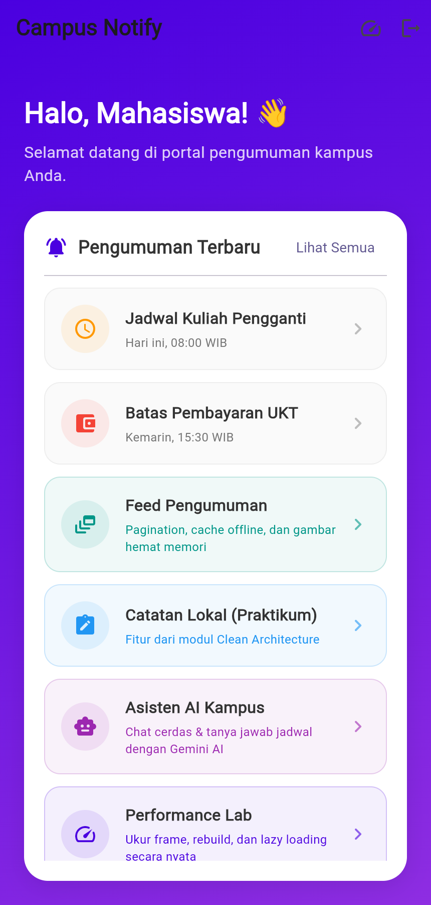
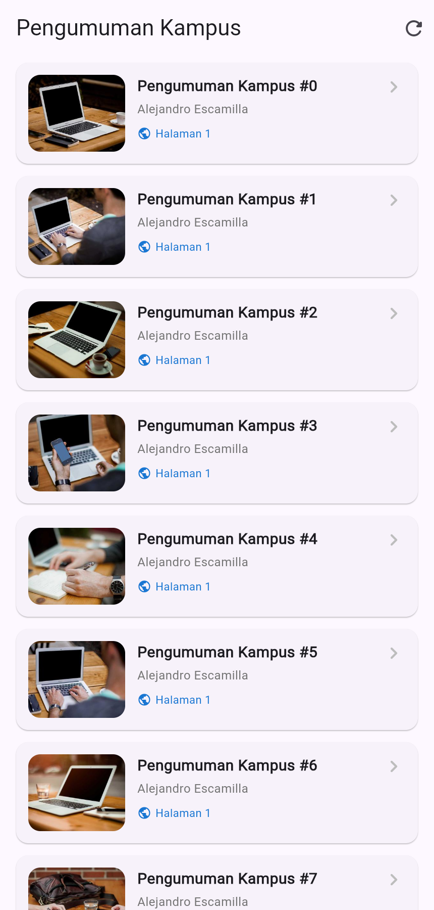
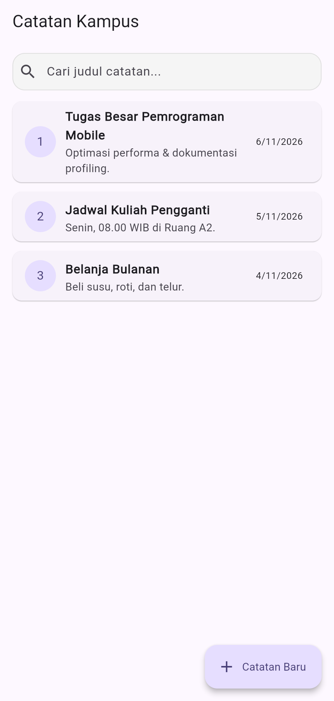
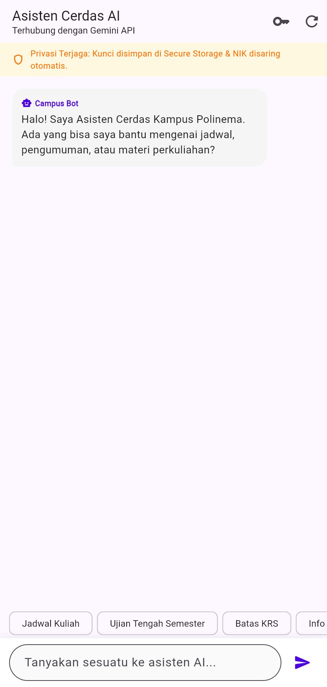
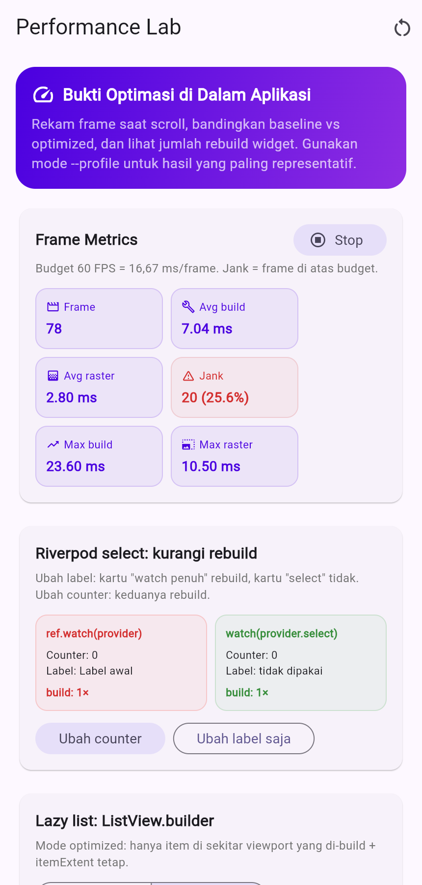
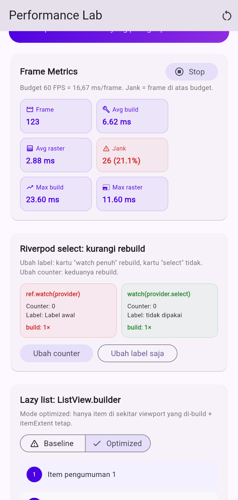
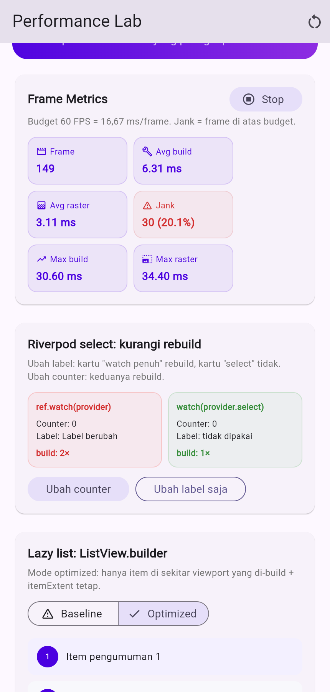
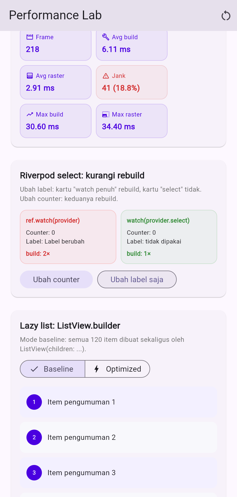
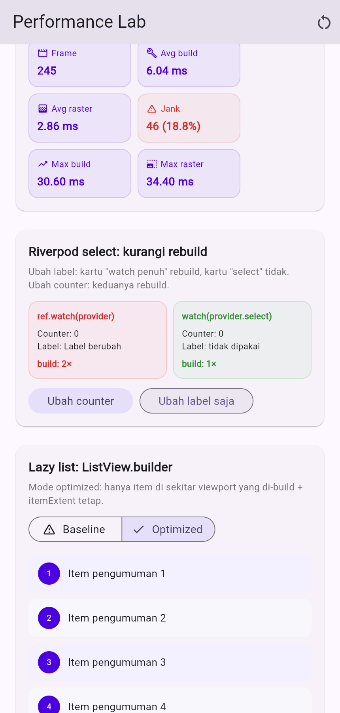

# Campus Notify — Week 11 Performance Optimization

Proyek ini adalah kelanjutan **Campus Notify** dari Week 7 (Clean Architecture)
yang dioptimasi pada Week 11. Fokusnya bukan menambah fitur sebanyak mungkin,
melainkan **mengukur, memperbaiki, dan membuktikan** peningkatan performa UI.

- **Nama**: Alfan Fahat Maulana
- **NIM**: 254107023007
- **Mata kuliah**: Pemrograman Mobile (Semester 5)
- **Flutter**: 3.47.1 (stable) · **Dart**: 3.13.1
- **Status quality gate**: `flutter analyze` bersih · `flutter test` 30/30 lulus

---

## Ringkasan Optimasi

| # | Teknik | Bukti |
| --- | --- | --- |
| 1 | `ListView.builder` + `itemExtent` | Demo 120 item di Performance Lab |
| 2 | `ref.watch(...select(...))` | Build counter `watch` vs `select` |
| 3 | `const` + ekstraksi widget | Kode Home/Notes/AI Chat |
| 4 | `RepaintBoundary` | Home & detail pengumuman |
| 5 | `MediaQuery.sizeOf` | Bubble chat AI |
| 6 | `CachedNetworkImage` + resize memori | Kartu & detail pengumuman |
| 7 | Cache-first + stale-while-revalidate + pagination | Feed pengumuman |
| 8 | Perbaikan lifecycle controller/listener | Unit + widget test |

Detail temuan dan laporan lengkap:

- [`docs/performance-findings.md`](docs/performance-findings.md) — proses
  menemukan masalah, bukti, akar penyebab, prioritas.
- [`docs/performance-report.md`](docs/performance-report.md) — laporan
  sebelum/sesudah, metrik, trade-off, dan refleksi.

---

## Fitur Baru di Week 11

### 1. Feed Pengumuman dengan Pagination & Cache

Halaman `/pengumuman` menampilkan feed dari Picsum Photos:

- **Pagination** 10 item per halaman dengan infinite scroll.
- **Cache-first + stale-while-revalidate**: cache halaman ditampilkan lebih
  dulu, lalu data segar menggantikannya.
- **Offline fallback**: jika jaringan gagal, data cache tetap tampil dengan
  banner “Mode offline”.
- **Pull-to-refresh** dan tombol muat ulang.
- **Skeleton loading**, error state per halaman, dan penanda “semua pengumuman
  sudah dimuat”.
- **Gambar hemat memori**: `CachedNetworkImage` dengan `memCacheWidth` dan
  `memCacheHeight` sesuai ukuran tampil.

### 2. Performance Lab

Halaman `/performance-lab` berisi bukti optimasi yang dapat dicoba langsung:

- **Frame Metrics** nyata dari `SchedulerBinding.addTimingsCallback`:
  jumlah frame, rata-rata & maksimum build/raster, jumlah dan persentase jank.
- **Demo rebuild**: kartu `ref.watch(provider)` vs
  `ref.watch(provider.select(...))` dengan build counter masing-masing.
- **Demo lazy list**: toggle Baseline (`ListView(children: ...)`) vs Optimized
  (`ListView.builder` + `itemExtent`).
- **Daftar optimasi** yang diterapkan beserta lokasinya.

### 3. Demo Entry Point Tanpa Firebase/SQLite

`lib/main_demo.dart` memungkinkan aplikasi dijalankan tanpa konfigurasi
Firebase dan tanpa database SQLite:

```bash
flutter run -t lib/main_demo.dart
```

Cocok untuk screenshot, demo di desktop/web, dan mencoba Performance Lab.

---

## Screenshots

Semua screenshot diambil dari `lib/main_demo.dart` pada Chromium
(viewport 430×900, skala 2×). Angka frame bersifat indikatif; lihat catatan di
[`docs/performance-report.md`](docs/performance-report.md).

### Dashboard & Fitur

| Home | Feed Pengumuman |
| :---: | :---: |
|  |  |
| <sub>Dashboard dengan widget const dan RepaintBoundary.</sub> | <sub>Pagination, cache offline, dan gambar hemat memori.</sub> |

| Catatan | AI Chat |
| :---: | :---: |
|  |  |
| <sub>ListView.builder dan pencarian dengan select.</sub> | <sub>Consumer terpisah dan MediaQuery.sizeOf.</sub> |

### Bukti Optimasi

| Performance Lab |
| :---: |
|  |
| <sub>Metrik FrameTiming nyata dan demo optimasi.</sub> |

| Select sebelum | Select sesudah |
| :---: | :---: |
|  |  |
| <sub>Build awal: watch 1×, select 1×.</sub> | <sub>Setelah “Ubah label saja”: watch 2×, select tetap 1×.</sub> |

| Lazy list baseline | Lazy list optimized |
| :---: | :---: |
|  |  |
| <sub>ListView(children:): 120 widget dibuat di awal.</sub> | <sub>ListView.builder + itemExtent: hanya item viewport.</sub> |

---

## Struktur Folder

```
11-week-11-performance-optimization/
├── lib/
│   ├── core/
│   │   └── performance/frame_metrics.dart      # FrameTiming -> metrik
│   ├── features/
│   │   ├── announcements/                      # Feed + cache + pagination
│   │   ├── ai/                                 # Chat AI yang dioptimasi
│   │   ├── notes/                              # List & search yang dioptimasi
│   │   └── performance_lab/                    # Demo & bukti optimasi
│   ├── pages/home_page.dart                    # Dashboard const + RepaintBoundary
│   ├── main.dart                               # Entry point aplikasi penuh
│   └── main_demo.dart                          # Entry point tanpa Firebase/SQLite
├── docs/
│   ├── performance-findings.md
│   └── performance-report.md
├── screenshots/
├── test/
│   ├── announcement_repository_test.dart
│   ├── announcement_feed_notifier_test.dart
│   └── ... (test dari Week 7 yang tetap dijaga)
├── pubspec.yaml
└── README.md
```

---

## Cara Menjalankan

### Prasyarat

- Flutter stable (proyek ini diuji dengan 3.47.1)
- Chrome/Edge untuk target web, atau Windows desktop
- Untuk aplikasi penuh: konfigurasi Firebase (`flutterfire configure`)

### 1. Install dependensi

```bash
flutter pub get
```

### 2. Jalankan demo (disarankan untuk review)

```bash
flutter run -t lib/main_demo.dart
```

Pilih device `chrome`, `edge`, atau `windows` saat diminta. Demo ini tidak
memerlukan Firebase maupun SQLite.

### 3. Jalankan aplikasi penuh

```bash
flutter run
```

### 4. Jalankan dalam mode profile

```bash
flutter run --profile -t lib/main_demo.dart
```

Mode profile diperlukan untuk angka frame yang representatif. Jangan menarik
kesimpulan performa dari mode debug.

### 5. Quality gate

```bash
dart format --set-exit-if-changed .
flutter analyze
flutter test
```

---

## Quality Gate (Hasil Nyata)

```text
$ dart format --set-exit-if-changed .
Formatted 53 files (0 changed) in 0.37 seconds.

$ flutter analyze
Analyzing 11-week-11-performance-optimization...
No issues found! (ran in 10.9s)

$ flutter test
00:03 +30: All tests passed!
```

Test yang ditambahkan pada Week 11:

| File | Fokus |
| --- | --- |
| `test/announcement_repository_test.dart` | Cache write, offline fallback, failure tanpa cache |
| `test/announcement_feed_notifier_test.dart` | Cache-first, pagination berhenti, error mempertahankan cache |

---

## Cara Membaca Bukti Performa

1. Buka **Performance Lab** dari Home (ikon kecepatan di AppBar atau kartu di
   dashboard).
2. Tekan **Reset metrik**, lalu scroll daftar demo beberapa kali.
3. Catat **Avg build**, **Avg raster**, **Jank**, dan nilai **Max**.
4. Pilih **Baseline** atau **Optimized**, ulangi langkah 2–3 dengan gerakan
   yang sama.
5. Tekan **Ubah label saja** untuk melihat kartu `watch` penuh bertambah build
   sementara kartu `select` tidak.

Angka frame adalah hasil pengukuran pada environment yang tercatat di
`docs/performance-report.md`. Angka tersebut **bukan janji performa** untuk
semua perangkat.

---

## Catatan Lingkungan

- Pengukuran dilakukan di Windows 11 + Chromium (web), bukan perangkat Android
  low-end. Emulator Android tidak tersedia saat pengerjaan.
- `flutter pub add` sempat gagal di Windows karena plugin membutuhkan
  **Developer Mode** (symlink). `pubspec.yaml` dan `pubspec.lock` tetap
  diperbarui dengan benar; build web tidak terpengaruh.
- Aplikasi penuh membutuhkan konfigurasi Firebase. Gunakan `main_demo.dart`
  untuk review performa tanpa konfigurasi tersebut.

---

## Referensi

- Codelab: <https://jti-polinema.github.io/flutter-codelab/11-minggu-11-performance-optimization/index.html>
- Flutter performance best practices:
  <https://docs.flutter.dev/perf/best-practices>
- `FrameTiming` API:
  <https://api.flutter.dev/flutter/dart-ui/FrameTiming-class.html>
- `cached_network_image`:
  <https://pub.dev/packages/cached_network_image>
- `shared_preferences`:
  <https://pub.dev/packages/shared_preferences>
