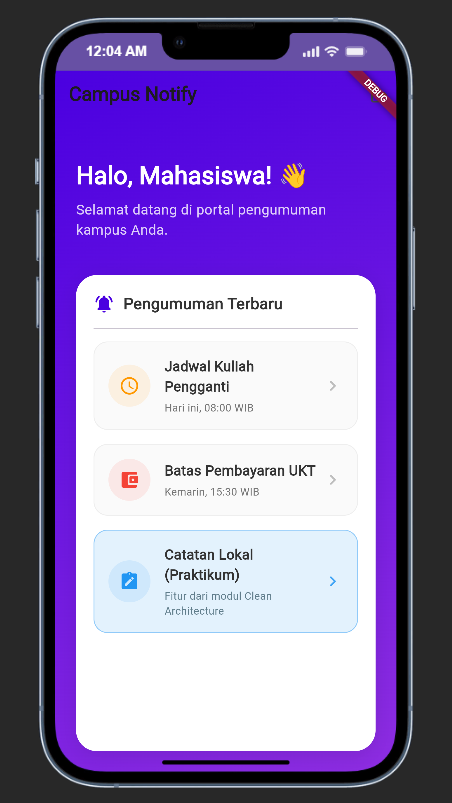

# Minggu 8: Mid Project Review & Code Review Portfolio

**Mata Kuliah:** Pemrograman Mobile  
**Nama Mahasiswa:** Mochammad Alfan Fadhilah  
**NIM:** 254107023007  
**Proyek Basis:** Campus Notify & Offline Notes (`Week7_Clean Architecture/campus_notify`)  

---

## 📌 Ringkasan Status Paruh Semester (Mid-Project Review)

Paruh pertama perkuliahan Pemrograman Mobile berfokus pada pembangunan fondasi arsitektur perangkat lunak yang andal, modular, dan teruji. Pada evaluasi tengah semester (*Mid Review*), proyek portofolio ini dievaluasi bukan hanya dari kuantitas fitur permukaan, melainkan dari **kedisiplinan arsitektur, kebersihan repositori (*git hygiene*), dan otomasi penjamin mutu (*quality gates*)**.

### Status Kelayakan:
- **Pemeriksaan Mesin:** ✅ **HIJAU LENGKAP** (0 error, 0 warning, 0 info pada `flutter analyze`, format seragam pada `dart format`, dan 10/10 test lulus pada `flutter test`).
- **Hygiene Kolaborasi:** ✅ Mengadopsi percabangan `develop` dan fitur terisolasi `feat/*`, bebas dari commit langsung ke `main`.
- **Integritas Arsitektur (Sterilitas):** ✅ Prinsip Clean Architecture (*Dependency Rule*) terbukti melalui pengujian `grep` otomatis.
- **Pencegahan Regresi (CI):** ✅ Pipeline GitHub Actions aktif menolak PR kotor secara otomatis.

---

## 🗺️ Peta Issue & Pull Request

| Tipe | Nomor / Identitas | Judul & Deskripsi | Branch | Status |
|---|---|---|---|---|
| **Issue** | [#12](docs/pr-template.md#issue-12-bug-pengguna-dapat-menyimpan-catatan-tanpa-judul) | `[Bug] Pengguna Dapat Menyimpan Catatan Tanpa Judul` | - | 🟢 **Closed via PR** |
| **Pull Request** | [PR #1](docs/pr-template.md#2-template-pull-request) | `feat(notes): validasi judul kosong + test` | `feat/notes-validation` $\rightarrow$ `develop` | 🟣 **Merged (Squash)** |
| **Commit Hygiene** | [f8afd18](docs/review-checklist.md#12-tabel-simulasi-perbaikan-pesan-commit-buruk) | `style: bersihkan 12 temuan static analysis dan rapikan dart format` | `feat/notes-validation` | 🟢 **Committed** |
| **Otomasi CI** | [13d7711](.github/workflows/ci.yml) | `ci: tambahkan workflow verifikasi PR pada github actions` | `feat/notes-validation` | 🟢 **Committed** |

Detail percakapan review sejawat dan temuan observasi dapat dilihat pada dokumen:  
📄 [Dokumentasi PR & Peer Review Lengkap](docs/pr-template.md)

---

## 🧱 Fitur Utama & Integritas Arsitektur

Aplikasi menggabungkan modul notifikasi kampus (*push messaging & auth*) dan modul pencatatan lokal (*offline notes*) dengan struktur **Feature-First Clean Architecture**:

```
lib/
├── core/                        # Komponen lintas fitur (Failures, ApiClient, Util)
├── features/
│   ├── auth/                    # Modul Autentikasi Mahasiswa
│   │   ├── data/                # TokenStore (SecureStorage), AuthRepositoryImpl
│   │   ├── domain/              # Entities, Repository Contract, LoginUseCase
│   │   └── presentation/        # LoginPage, AuthProviders (Riverpod)
│   └── notes/                   # Modul Catatan Kampus
│       ├── data/                # NoteModel, NoteRepositoryImpl (SQLite)
│       ├── domain/              # Note Entity, NoteRepository, UseCases (GetNotes, AddNote)
│       └── presentation/        # NotesPage, NotesProviders
├── messaging/                   # Firebase Messaging & Local Notification Service
└── pages/                       # AnnouncementDetailPage, HomePage (Dashboard)
```

### Aturan Ketergantungan (Dependency Rule) Terbukti:
1. **Domain Layer Murni Dart:** 0 impor ke package UI atau eksternal. Logika bisnis dapat diuji tanpa simulator/emulator.
2. **Presentation Bebas Raw Driver:** UI hanya berinteraksi melalui Use Case `GetNotes` dan `AddNote`.
3. **Validasi Terpusat di Use Case:** Menolak judul kosong atau whitespace dan mengembalikan `ValidationFailure` yang terstruktur.

---

## 🛠️ Stack Teknologi

- **Bahasa & SDK:** Dart 3.13.1 / Flutter 3.47.1 (Channel Stable)
- **State Management & DI:** `flutter_riverpod` (AsyncNotifierProvider, Provider, FutureProvider)
- **Database Lokal:** `sqflite` & `path`
- **Keamanan Kredensial:** `flutter_secure_storage`
- **Networking & Interceptor:** `dio`
- **Cloud Messaging:** `firebase_core`, `firebase_messaging`, `flutter_local_notifications`
- **Routing:** `go_router` (dengan deep linking & query parameters)
- **Continuous Integration (CI):** GitHub Actions Workflow (`.github/workflows/ci.yml`)

---

## 🚀 Cara Menjalankan Aplikasi & Pengujian

### 1. Menjalankan Aplikasi
Masuk ke direktori proyek `campus_notify`:
```bash
cd "Week7_Clean Architecture/campus_notify"
flutter pub get
flutter run
```

### 2. Menjalankan Tiga Pemeriksaan Mesin (Quality Gates)
Pastikan seluruh status pemeriksaan berwarna hijau sebelum membuka PR:
```bash
# 1. Pengecekan Analisis Statis Kode
flutter analyze

# 2. Verifikasi Konsistensi Formatting
dart format --set-exit-if-changed .

# 3. Eksekusi Seluruh Rangkaian Unit Test
flutter test
```

---

## 📊 Hasil yang Dicapai (Bukti Mesin Hijau)

### 1. Hasil `flutter analyze`
```text
Analyzing campus_notify...
No issues found! (ran in 5.3s)
```
*Status: 0 issues found (12 temuan lama telah dibersihkan secara tuntas).*

### 2. Hasil `dart format --set-exit-if-changed .`
```text
Formatted 26 files (0 changed) in 0.13 seconds.
```
*Status: 100% file mematuhi konvensi formatting resmi Dart.*

### 3. Hasil `flutter test`
```text
00:00 +0: loading test/auth_push_test.dart
00:00 +1: routeFromMessage menangani route kosong dan tanpa slash
00:00 +2: data payload membawa id pengumuman
00:00 +3: provider auth membaca status login dari token
00:00 +4: refresh gagal -> sesi dibersihkan (paksa login ulang)
00:00 +5: GetNotes meneruskan daftar dari repository
00:00 +6: GetNotes meneruskan failure tanpa melempar
00:00 +7: AddNote Validation Tests Harus mengembalikan ValidationFailure jika judul kosong
00:00 +8: AddNote Validation Tests Harus mengembalikan ValidationFailure jika judul hanya berisi spasi (edge case whitespace)
00:00 +9: AddNote Validation Tests Berhasil menyimpan catatan jika judul valid dan format sudah di-trim
00:00 +10: AddNote Validation Tests Meneruskan kegagalan jika repository mengalami error database
00:00 +10: All tests passed!
```
*Status: 10 dari 10 pengujian unit berhasil lolos.*

---

## 📸 Tangkapan Layar (Screenshots)

| Tampilan Beranda Dashboard | Halaman Catatan (Clean Architecture) |
|:---:|:---:|
|  |  |
| *Dashboard pengumuman kampus & navigasi cepat* | *Manajemen catatan terintegrasi usecase & SQLite* |

---

## 🧠 Refleksi Kritis (Reflective Engineering)

### 1. Apa beda LGTM ("Looks Good To Me") buta dengan approve yang bertanggung jawab? Apa risikonya bagi tim?
- **LGTM Buta:** Reviewer hanya melihat perubahan kode secara sekilas tanpa benar-benar membaca logika, tanpa meng-checkout branch secara lokal, dan tanpa menjalankan pengujian maupun verifikasi arsitektur. Sikap ini memperlakukan review sekadar formalitas birokrasi penekan tombol.
- **Approve yang Bertanggung Jawab:** Reviewer secara aktif bertindak sebagai *gatekeeper* kualitas. Reviewer memvalidasi kebenaran alur (*happy path* & *error path*), menguji *edge cases* (seperti nilai null, string whitespace, kondisi offline), memastikan tidak ada pelanggaran *Dependency Inversion*, serta memastikan tersedianya unit test yang memadai.
- **Risiko bagi Tim:** LGTM buta meloloskan *silent bug* ke production, meningkatkan *technical debt* yang menumpuk tak terlihat, merusak integritas arsitektur lapisan kode, dan pada akhirnya menciptakan budaya kerja yang tidak saling peduli (*lack of engineering accountability*).

### 2. Kapan komentar wajib berstatus *Request Changes*, dan kapan cukup saran (*Nitpick / Suggestion*)?
- **Wajib *Request Changes*:**
  1. Adanya cacat logika (*correctness issue*) yang berpotensi menyebabkan crash, memory leak, atau *data loss* (misalnya: tidak memvalidasi string kosong sehingga database menyimpan entri korup).
  2. Pelanggaran batas arsitektur (*architectural breach*), seperti UI mengakses database SQLite secara langsung tanpa use case / repository interface.
  3. Kode baru mengubah perilaku fungsional namun tidak disertai *unit test* sebagai jaring pengaman regresi.
  4. Pemeriksaan mesin gagal (`flutter analyze` menghasilkan error/warning atau CI merah).
- **Cukup Saran (*Suggestion / Nit*):**
  1. Preferensi gaya penamaan variabel minor yang tidak melanggar aturan linter.
  2. Penataan komentar kode atau refactoring kecil yang opsional dan tidak memengaruhi kinerja maupun keterbacaan secara signifikan.
  3. Saran optimasi mikro prematur yang tidak memblokir fungsionalitas inti saat ini.

### 3. Bagian mana dari review AI yang Anda tolak atau sederhanakan, dan mengapa?
Dalam proses pengembangan modul ini, saya menolak dan menyederhanakan beberapa rekomendasi dari AI:
1. **Menolak Penggunaan Package Validasi Pihak Ketiga di Domain:** AI sempat menyarankan mengimpor package formulir eksternal. Saya menolak saran ini karena domain layer wajib steril dari dependensi pihak ketiga (*Plain Dart*). Menggunakan manipulasi string native `.trim().isEmpty` jauh lebih efisien, ringan, dan menjaga kemurnian Clean Architecture.
2. **Menolak Pola Melempar Exception:** AI mengusulkan `throw Exception()` pada usecase saat validasi gagal. Saya menolak usulan tersebut dan menggantinya dengan fungsional tuple return `({Note? note, Failure? failure})` menggunakan `ValidationFailure`. Hal ini mencegah *unhandled runtime crash* di UI dan membuat penanganan error bersifat eksplisit (*type-safe*).
3. **Menyederhanakan Pipeline CI:** AI mengusulkan workflow CI yang melakukan build penuh bundel Android APK. Saya menyederhanakannya menjadi pemeriksaan *fast-feedback* (`dart format`, `flutter analyze`, `flutter test`), yang berjalan dalam hitungan detik sehingga hemat kuota runner dan tidak memperlambat laju pengembang.

### 4. Satu hal konkret yang Anda perbaiki setelah review sejawat — apa dampaknya?
- **Hal Konkret yang Diperbaiki:** Penanganan *edge case* karakter spasi (*whitespace-only*) pada validasi judul catatan di usecase `AddNote` dan pemeliharaan status dialog UI saat terjadi error.
- **Dampak Nyata:**
  1. **Integritas Basis Data:** Mencegah pengguna menyimpan catatan kosong yang hanya berisi tombol spasi atau spasi berlapis, sehingga database lokal tetap bersih dan terhindar dari *corrupted empty records*.
  2. **Pengalaman Pengguna (UX):** Pengguna tidak lagi kehilangan teks deskripsi yang sudah diketik hanya karena dialog tertutup otomatis; dialog tetap terbuka dengan pesan `errorText` merah yang jelas memberitahu apa yang perlu diperbaiki.
  3. **Keandalan Jangka Panjang:** Perilaku ini diikat oleh unit test otomatis `validate_note_test.dart` sehingga siapa pun yang memodifikasi fitur di kemudian hari tidak akan memecahkan validasi tersebut secara tidak sengaja (*regression prevention*).
